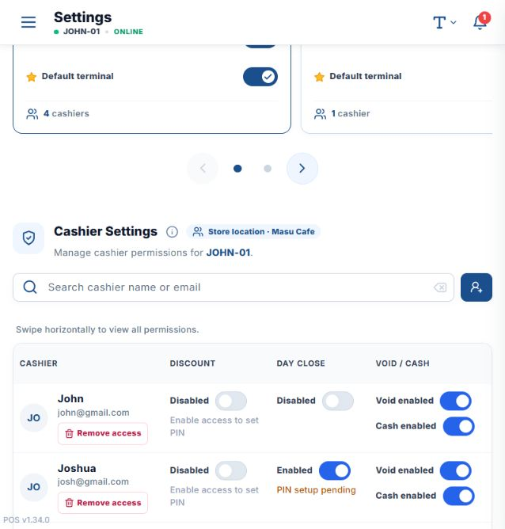
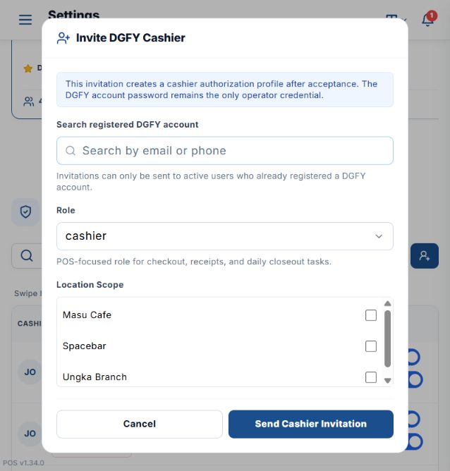

# Invite a new cashier in POS

## Before you start

- Use a master-admin account with access to POS settings.
- The cashier must already have an active, registered DGFY account. POS does not create a new
  username or password in this flow.

## Invite the cashier

1. Open the local POS: `http://localhost:5174/?view=settings_pos#/terminal`.
2. Sign in as the master admin and select the company.
3. Open **Settings**.
4. Select **POS Setup**.
5. Select **Terminals**.
6. Select the terminal that the cashier will use, such as **JOHN-01**.
7. In **Cashier Settings**, select **Invite Cashier**.

   

8. In **Search registered DGFY account**, search by the cashier's email address or phone number.
9. Select the matching active DGFY account.
10. Leave **Role** as **cashier**.
11. Under **Location Scope**, select every branch where the cashier is allowed to work.

    

12. Select **Send Cashier Invitation**.
13. Ask the cashier to accept the invitation from email or from **DGFY My Account → Business**.
14. Refresh **Cashier Settings** and confirm the accepted cashier appears in the terminal table.
15. If the cashier is not assigned to the selected terminal, use **Assign [cashier] to terminals**
    and save the assignment.

## Enable cashier permissions

In the cashier's row, enable only the permissions the role needs:

- **Can authorize discounts** — allows the cashier to approve POS discounts after a discount PIN
  is configured.
- **Can generate Z-reading** — allows the cashier to perform Day Close after their personal Day
  Close PIN is configured. See [Configure and generate a POS Z-reading](POS_Z_READING_GUIDE.md).
- **Can void POS transactions** and **Can refund cash and adjust drawer** — enable only when the
  cashier's operating duties require them.

The invitation itself was not sent during verification; the form was opened and canceled only.
