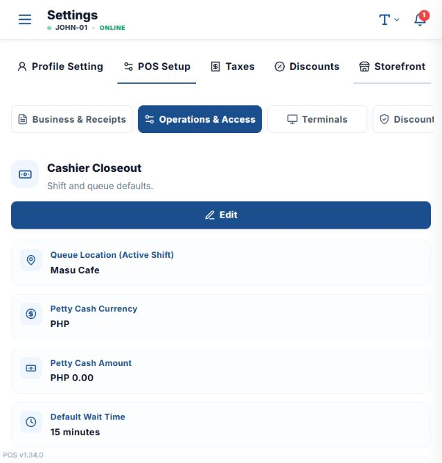
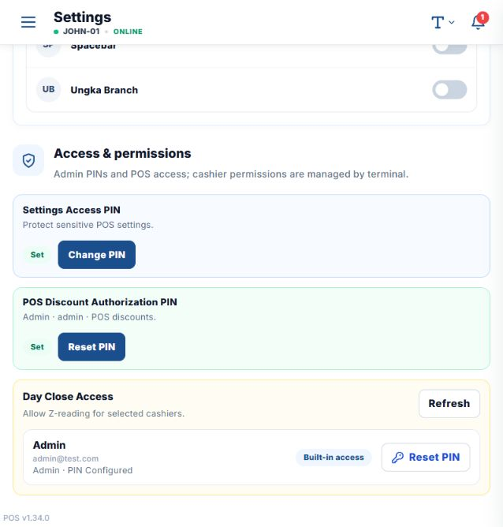
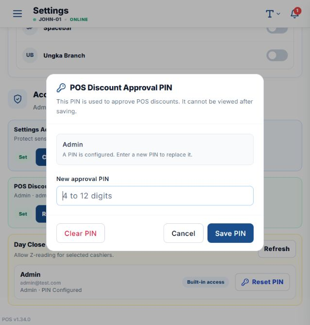

# Configure the POS discount approval PIN

## Configure the PIN

1. Open the local POS: `http://localhost:5174/?view=settings_pos#/terminal`.
2. Sign in as the master admin and select the company.
3. Open **Settings**.
4. Select **POS Setup**.
5. Select **Operations & Access**.

   

6. Scroll to **Access & permissions**.
7. Under **POS Discount Authorization PIN**, select **Set**. If a PIN already exists, select
   **Reset PIN**.

   

8. Enter a new PIN containing **4 to 12 digits**.
9. Select **Save PIN**. The PIN cannot be viewed after saving.

   

## Apply a discount with the PIN

1. Open the POS selling screen and start the shift.
2. Add the item to the sale.
3. Select **Apply Discount**.
4. Select the discount type and complete its required fields.
5. Select the **Authorizing employee**.
6. Enter that employee's **Employee PIN**.
7. Select **Apply Discount**.

The authorizing employee must have POS discount authorization and a configured PIN. Never share the
PIN or enter it into a screenshot.
