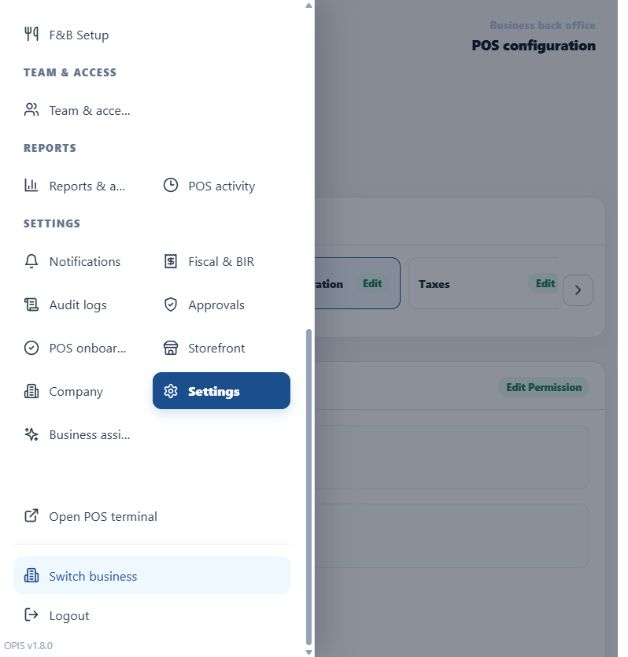
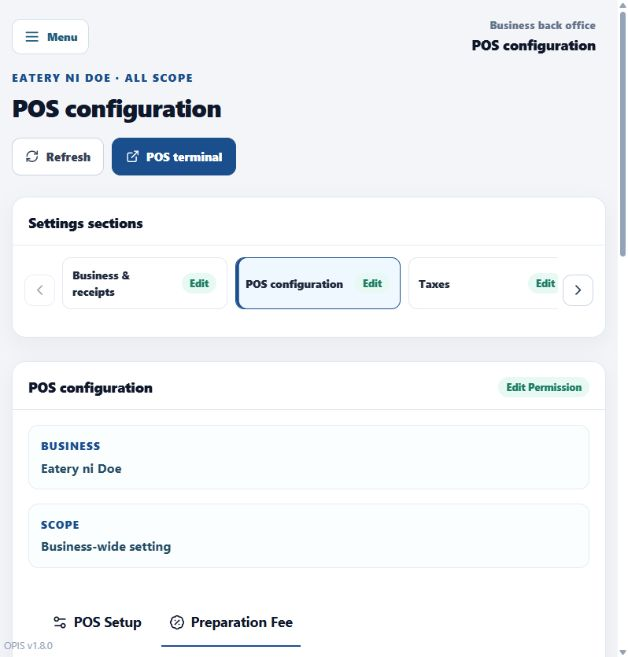
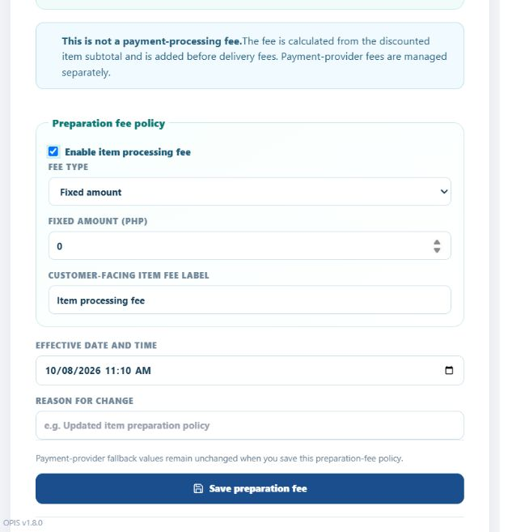
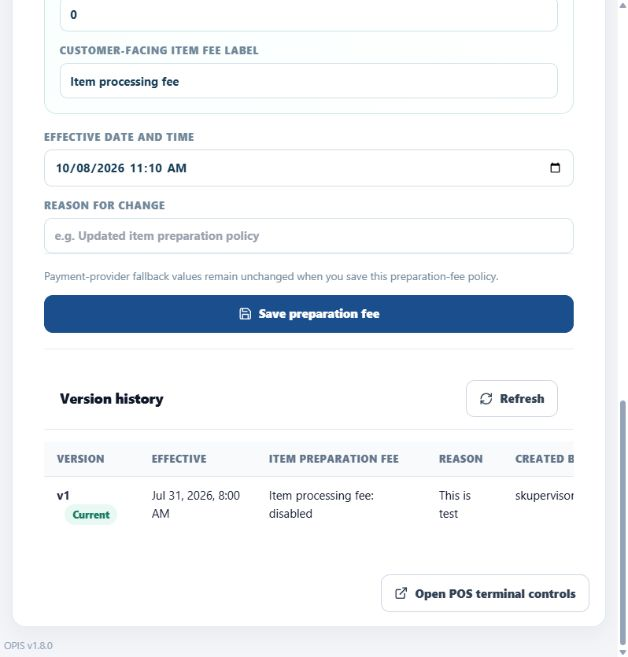

# Configure the item-processing fee in OPIS

Use a tenant Owner or authorized fee-policy editor. This is an item-preparation fee, not a payment
processing fee.

## Step-by-step

1. Open `https://opis.dgfy.ph/` and sign in.
2. Click **Menu**, scroll to **Settings**, and select **Settings**.

   

3. Select **POS configuration**.

   

4. Select the **Preparation Fee** tab.
5. Turn on **Enable item processing fee**.

   

6. Select **Fixed amount** or **Percentage**.
7. Enter the amount or percentage.
8. Enter the **Customer-facing item fee label**.
9. Set the **Effective date and time**.
10. Enter the **Reason for change**. Use 3–500 characters.
11. Select **Save preparation fee**.

   

12. Confirm the success message and check **Version history**.
