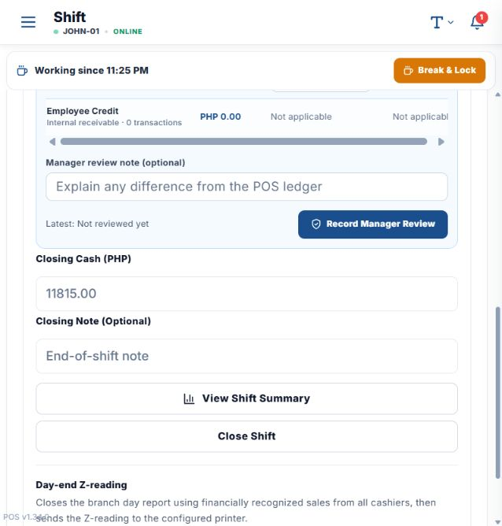
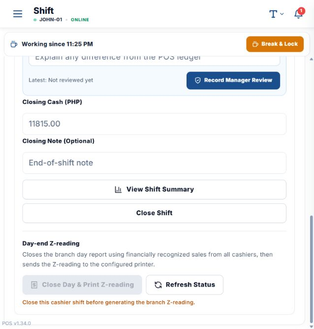

# Configure and generate a POS Z-reading

## 1. Give the cashier Day Close access

1. Open the local POS: `http://localhost:5174/?view=settings_pos#/terminal`.
2. Sign in as a master admin and select the company.
3. Open **Settings → POS Setup → Terminals**.
4. Select the terminal and find the cashier in **Cashier Settings**.
5. In the **DAY CLOSE** column, enable **Can generate Z-reading for [cashier]**.
6. Ask the cashier to create their personal Day Close PIN in **DGFY Business**. The PIN is
   personal; an admin can see its status or reset it, but cannot view the PIN.

## 2. Close the cashier shift

1. Open the POS **Shift** screen. The direct local route is:
   `http://localhost:5174/?view=shift_controls#/terminal`.
2. Select **Close Shift**.
3. Review the POS totals and reconcile the observed GCash, Maya, card-terminal, and bank-transfer
   amounts.
4. Enter the counted amount in **Closing Cash (PHP)**.
5. Add a **Closing Note (Optional)** when a variance needs explanation.
6. Select **Close Shift** and complete the confirmation.

   

7. Repeat this for every open cashier shift in the same branch.

## 3. Generate and print the branch Z-reading

1. Stay on **Shift → Close Shift** and scroll to **Day-end Z-reading**.
2. Confirm every cashier shift in the branch is closed. If the action is disabled, select
   **Refresh Status** and close the remaining shifts shown by POS.
3. Select **Close Day & Print Z-reading**. If the branch was already closed, the action changes to
   **Print Z-reading**.
4. Enter your personal **POS Day Close PIN** when prompted.
5. Select **Confirm & Print Z-reading**.
6. Use the configured printer or the browser print preview when no POS printer is configured.

   

The Z-reading is branch-wide and includes financially recognized sales from all cashiers and
completed online orders. Never share a Day Close PIN or put it in a screenshot.

## Local verification note

The navigation and controls were verified in the local POS. During verification, the local Shift
screen reported:

`Unknown column 'reading_payload_hash' in 'field list'`

Because of that local database-schema error, no shift was closed and no Z-reading was generated.
The guide is ready for use after the pending database migration is applied.
