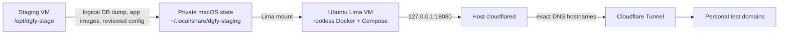

# Local Staging Recovery Runbook

Use this temporary recovery path when `stage.dgfy.ph` is unavailable and staging cannot be tested. It snapshots the running staging stack from `sieitz-dgfy-remote:/opt/dgfy-stage`, runs that snapshot in a local Lima VM, and exposes selected test hostnames through a Cloudflare Tunnel. It is a local point-in-time clone, not a second canonical staging environment or a release/promotion path.

When `stage.dgfy.ph` is healthy again, use it as the normal staging environment and stop the local tunnel. The local snapshot does not receive later staging updates automatically.

## Topology



## Safety boundaries

1. Staging dumps, uploads, `.env`, connection files, tunnel certificates, tunnel credentials, and Mailpit passwords stay under `~/.local/share/dgfy-staging`. Do not commit them, put them in `.tmp/`, or paste their contents into logs or chat.
2. Treat the database snapshot and uploads as potentially containing personal data. Restrict the state directory to the local operator (`0700`); keep `.env`, database dumps, tunnel credentials, and plaintext password reminders at `0600`.
3. Do not copy the remote MySQL data directory or Redis data directory. Export a logical database dump and restore it into a fresh local MySQL volume.
4. Use the exact images running on staging. Record their image IDs/digests in the private `data/images.map`; do not substitute a moving `latest` app image.
5. Use sandbox credentials and disable or redirect real email, payment, SMS, and webhook side effects before opening the tunnel. Mailpit is the only SMTP destination for this clone. Do not point a live provider webhook at the temporary hostname.
6. Treat every tunneled hostname as internet-facing. The example protects the Mailpit UI with Basic Auth, but provides no tunnel-level access control for DGFY. Before exposing a snapshot with personal or confidential data, configure Cloudflare Access for all six hostnames or sanitize the snapshot first.
7. Do not use `docker compose down -v` during cleanup; it deletes the local database and Mailpit volumes.

## Prerequisites and private state

This procedure assumes macOS, a working SSH alias named `sieitz-dgfy-remote`, Lima, Docker Compose supplied by Lima's Docker template, `rsync`, `gzip`, `shasum`, `cloudflared`, and `htpasswd` are available. Creating the Lima VM and named tunnel does not require host `sudo`; Lima provisions Docker in the guest.

Create the private host directories:

```bash
STATE="$HOME/.local/share/dgfy-staging"
umask 077
mkdir -p "$STATE"/{config,data,source/dgfy,source/dglaundry,cloudflared,logs}
mkdir -p "$STATE/data/dgfy-api/uploads" "$STATE/data/dgfy-api/storage"
chmod 700 "$STATE" "$STATE/config" "$STATE/data" "$STATE/data/dgfy-api" \
  "$STATE/data/dgfy-api/uploads" "$STATE/data/dgfy-api/storage" \
  "$STATE/source" "$STATE/source/dgfy" "$STATE/source/dglaundry" \
  "$STATE/cloudflared" "$STATE/logs"
```

Keep the following layout between incidents if local disk space allows:

```text
~/.local/share/dgfy-staging/
  config/       # local-only restore/grant helpers and Mailpit password reminder
  data/         # SQL dumps, image archive/map, and copied uploads/storage
  source/dgfy/  # reviewed Compose inputs plus local-only overlay/proxy config
  cloudflared/  # config.yml, cert.pem, and tunnel UUID JSON credentials
  logs/         # tunnel and local Compose diagnostics
```

Do not sync this directory to a shared or public location. If it is lost, repeat the snapshot steps below rather than trying to recover secrets from the repository.

## Capture a point-in-time staging snapshot

First verify SSH and inspect the active Compose service names without printing `.env` values or expanded Compose configuration:

```bash
ssh -o BatchMode=yes sieitz-dgfy-remote 'cd /opt/dgfy-stage && docker compose config --services'
```

Capture while the staging release is stable; do not overlap a promotion or deploy. Record the current app image references/IDs in the private image map and note the dump time so the data and image set can be matched later.

Copy only the Compose file, `.env`, and configuration files required by that Compose project. Do not recursively mirror `/opt/dgfy-stage`; it may contain live volume data, backups, logs, or unrelated secrets. Adjust the Compose filename if the active remote uses a different one:

```bash
rsync -a --partial --protect-args \
  sieitz-dgfy-remote:/opt/dgfy-stage/docker-compose.yml \
  "$STATE/source/dgfy/"
rsync -a --partial --protect-args \
  sieitz-dgfy-remote:/opt/dgfy-stage/.env \
  "$STATE/source/dgfy/.env"
chmod 600 "$STATE/source/dgfy/.env"
```

Export the images referenced by running staging services and stream the archive directly to the private host directory. This avoids writing an intermediate archive onto the remote VM:

```bash
set -euo pipefail
IMAGE_TMP="$STATE/data/dgfy-stage-images.tar.gz.partial"
ssh sieitz-dgfy-remote \
  'cd /opt/dgfy-stage && docker image save $(docker compose images -q | sort -u)' \
  | gzip -1 > "$IMAGE_TMP"
gzip -t "$IMAGE_TMP"
mv "$IMAGE_TMP" "$STATE/data/dgfy-stage-images.tar.gz"
shasum -a 256 "$STATE/data/dgfy-stage-images.tar.gz" \
  > "$STATE/data/dgfy-stage-images.sha256"
chmod 600 "$STATE/data/dgfy-stage-images.tar.gz" "$STATE/data/dgfy-stage-images.sha256"
```

If `docker compose images -q` returns no image IDs, stop and inspect the active Compose project instead of saving unrelated Docker images. Keep a private image map with each service's reference and immutable image ID/digest; the running containers are the snapshot source.

Create a logical dump of all non-system schemas in the active DGFY MySQL service. Confirm the database service name from `config --services` first; the example below uses `mysql`:

```bash
DB_SERVICE=mysql
SQL_TMP="$STATE/data/dgfy-stage.sql.gz.partial"
set -euo pipefail
ssh sieitz-dgfy-remote \
  "cd /opt/dgfy-stage && docker compose exec -T $DB_SERVICE bash -se" \
  <<'REMOTE' | gzip -1 > "$SQL_TMP"
set -euo pipefail
export MYSQL_PWD="${MYSQL_ROOT_PASSWORD:?MYSQL_ROOT_PASSWORD is unavailable in the database container}"
mapfile -t schemas < <(
  mysql --protocol=socket --user=root --batch --skip-column-names \
    -e 'SHOW DATABASES' \
    | grep -Ev '^(information_schema|mysql|performance_schema|sys)$'
)
((${#schemas[@]} > 0))
exec mysqldump --protocol=socket --user=root \
  --single-transaction --routines --events --triggers --hex-blob \
  --databases "${schemas[@]}"
REMOTE
gzip -t "$SQL_TMP"
mv "$SQL_TMP" "$STATE/data/dgfy-stage.sql.gz"
shasum -a 256 "$STATE/data/dgfy-stage.sql.gz" \
  > "$STATE/data/dgfy-stage.sql.sha256"
chmod 600 "$STATE/data/dgfy-stage.sql.gz" "$STATE/data/dgfy-stage.sql.sha256"
```

`--single-transaction` gives a consistent snapshot for InnoDB tables. Coordinate the dump so schema-changing DDL is not running; nontransactional tables need a write freeze or an approved lock-based backup method. If DGLaundry is also needed, export its database separately with its own active DB service and credentials. Never include MySQL's `mysql` system database in the application dump; create local app-user grants after restore.

Copy uploads/storage only if the test flows need them. Keep the same private-data protections:

```bash
rsync -a --partial --protect-args \
  sieitz-dgfy-remote:/opt/dgfy-stage/data/dgfy-api/uploads/ \
  "$STATE/data/dgfy-api/uploads/"
rsync -a --partial --protect-args \
  sieitz-dgfy-remote:/opt/dgfy-stage/data/dgfy-api/storage/ \
  "$STATE/data/dgfy-api/storage/"
```

Check the actual bind-mount paths in the reviewed Compose file before using these two examples. Do not copy `data/mysql` or `data/redis`.

## Create or start the Lima VM

Create the VM once. Lima's Docker template installs Docker; the extra mount exposes only the private recovery directory, and the two static forwards expose the local edge proxy and Mailpit UI on host loopback:

```bash
limactl start \
  --name=dgfy-staging \
  --vm-type=qemu \
  --arch=x86_64 \
  --cpus=4 \
  --memory=6 \
  --disk=60 \
  --mount-only "$STATE:w" \
  --port-forward=18080:18080,static=true \
  --port-forward=18025:18025,static=true \
  template:docker
```

On later runs, use `limactl start dgfy-staging`. Confirm the instance and Docker are ready:

```bash
limactl list
limactl shell dgfy-staging -- docker info
```

Lima defaults host-side port forwards to `127.0.0.1`; if editing `~/.lima/dgfy-staging/lima.yaml`, keep `hostIP: "127.0.0.1"` for both forwards. The Compose port mappings below also bind to loopback.

## Prepare the local Compose project

Copy the reviewed project inputs from the host mount into the guest's disk-backed home directory. Keep MySQL and Redis data directories fresh; copy only application uploads/storage when needed:

```bash
limactl shell dgfy-staging -- bash -lc '
  set -euo pipefail
  mkdir -p "$HOME/dgfy-staging/dgfy" "$HOME/dgfy-staging/snapshots"
  cp -a /mnt/dgfy-staging/source/dgfy/. "$HOME/dgfy-staging/dgfy/"
  cp -a /mnt/dgfy-staging/data/dgfy-stage.sql.gz "$HOME/dgfy-staging/snapshots/"
  cp -a /mnt/dgfy-staging/data/dgfy-stage-images.tar.gz "$HOME/dgfy-staging/snapshots/"
  mkdir -p "$HOME/dgfy-staging/dgfy/data/dgfy-api"
  if [ -d /mnt/dgfy-staging/data/dgfy-api ]; then
    cp -a /mnt/dgfy-staging/data/dgfy-api/. "$HOME/dgfy-staging/dgfy/data/dgfy-api/"
  fi
  mkdir -p "$HOME/dgfy-staging/dgfy/data/mysql" "$HOME/dgfy-staging/dgfy/data/redis"
'
```

Load the captured images and verify that the Compose image tags match the snapshot map. The local overlay example pins the proxy and Mailpit images by digest; pull those exact images before starting Compose:

```bash
limactl shell dgfy-staging -- bash -lc '
  gzip -dc "$HOME/dgfy-staging/snapshots/dgfy-stage-images.tar.gz" | docker image load
  docker pull nginx@sha256:72aeb3308ef6cb3118242fb16389518923916dfa206e32d1a8377acc328b9870
  docker pull axllent/mailpit@sha256:94f6b70c1436defae6799d9ac7ff0eeff9540465b842026d5cdb018f1c0234ea
'
```

Copy the checked-in examples into the private project directory beside the reviewed `docker-compose.yml`:

```bash
cp docs/ops/examples/local-staging/docker-compose.local.yml "$STATE/source/dgfy/"
cp docs/ops/examples/local-staging/nginx-local.conf "$STATE/source/dgfy/"
```

The [local Compose overlay](examples/local-staging/docker-compose.local.yml) and [Nginx proxy example](examples/local-staging/nginx-local.conf) are local-only templates. The overlay:

- set `pull_policy: never` on the captured staging services;
- publish the edge proxy as `127.0.0.1:18080:80`;
- publish Mailpit's UI as `127.0.0.1:18025:8025` and leave SMTP port `1025` internal to the Compose network;
- mount `nginx-local.conf` read-only into the edge proxy; and
- require an `mailpit-ui.htpasswd` file for the Mailpit UI and an SMTP htpasswd file for the application-to-Mailpit connection.

The proxy routes the five DGFY names below to the matching Compose services (`dgfy-storefront`, `dgfy-pos`, `dgfy-ims`, `dgfy-opis`, `dgfy-api`), returns 404 for an unknown host, and routes `dgfy-mail` to `mailpit:8025`. The temporary frontend proxy also rewrites embedded legacy staging origins to the personal API/app origins; keep those substitutions in this local proxy only, not in application or production config. If adding the optional DGLaundry vhost, start its local stack and create its expected shared Docker network first.

Create bcrypt htpasswd entries interactively so the plaintext password is not written in shell history:

```bash
htpasswd -B -c "$STATE/source/dgfy/mailpit-ui.htpasswd" mailpit
htpasswd -B -c "$STATE/source/dgfy/smtp.htpasswd" dgfy-local
chmod 644 "$STATE/source/dgfy/mailpit-ui.htpasswd" "$STATE/source/dgfy/smtp.htpasswd"
```

The `-c` option creates or replaces each file; do not rerun these commands unless rotating the credentials. The htpasswd files contain hashes and are readable by the Mailpit container; keep their parent directory private. If keeping a local plaintext login reminder, store it at `config/mailpit-ui-credentials.txt` with mode `0600`. Configure the app's SMTP variables to use host `mailpit`, port `1025`, username `dgfy-local`, and the matching password. Never expose SMTP port `1025` through Lima or the tunnel.

## Set local origins and side effects

Update the private `.env` for the local clone. The current local hostname mapping is:

| Purpose | Hostname |
| --- | --- |
| Storefront | `dgfy-store.nicenature.space` |
| POS | `dgfy-pos.nicenature.space` |
| IMS | `dgfy-ims.nicenature.space` |
| OPIS | `dgfy-opis.nicenature.space` |
| API | `dgfy-api.nicenature.space` |
| Mailpit UI | `dgfy-mail.nicenature.space` |

The local setup used these public-origin values:

| Variable | Local value |
| --- | --- |
| `STOREFRONT_PUBLIC_ORIGIN` | `https://dgfy-store.nicenature.space` |
| `STOREFRONT_DOMAIN` | `dgfy-store.nicenature.space` |
| `POS_DOMAIN` | `dgfy-pos.nicenature.space` |
| `SKUPERVISOR_DOMAIN` | `dgfy-ims.nicenature.space` |
| `APP_URL` | `https://dgfy-ims.nicenature.space` |
| `DGFY_OIDC_ISSUER` | `https://dgfy-api.nicenature.space` |
| `PAYMONGO_WEBHOOK_ENDPOINT_URL` | `https://dgfy-api.nicenature.space` |
| `CORS_ORIGIN` | HTTPS origins for Storefront, POS, IMS, and OPIS; retain the current config's list format |
| `EMAIL_FROM` | `nicenature.space` |

Recheck these names and value formats against the current `.env.example`/Compose contract before reusing this runbook. Keep the local `DB_HOST` and Redis URL pointed at the Compose services (`mysql` and `redis`). Use sandbox provider keys and test-only callback targets. Disable integrations that can send real messages, charge money, or mutate external systems. Do not assume that a tunnel hostname makes staging credentials safe.

After editing `.env` and creating the local overlay/auth files under the host state directory, sync those private inputs into the guest project. This updates files copied earlier in the preparation step:

```bash
limactl shell dgfy-staging -- bash -lc '
  set -euo pipefail
  project="$HOME/dgfy-staging/dgfy"
  cp /mnt/dgfy-staging/source/dgfy/.env "$project/.env"
  cp /mnt/dgfy-staging/source/dgfy/docker-compose.local.yml "$project/"
  cp /mnt/dgfy-staging/source/dgfy/nginx-local.conf "$project/"
  cp /mnt/dgfy-staging/source/dgfy/mailpit-ui.htpasswd "$project/"
  cp /mnt/dgfy-staging/source/dgfy/smtp.htpasswd "$project/"
  chmod 600 "$project/.env"
'
```

## Restore and start the clone

Check the merged Compose files without printing expanded configuration, then start only the local databases:

```bash
limactl shell dgfy-staging -- bash -lc '
  set -euo pipefail
  cd "$HOME/dgfy-staging/dgfy"
  docker compose -f docker-compose.yml -f docker-compose.local.yml config --quiet
  docker compose -f docker-compose.yml -f docker-compose.local.yml up -d mysql redis
'
```

After MySQL is healthy, restore the logical dump into the fresh local database container. The Compose project name in the current staging file is `dgfy-platform-staging`; if that name changes, resolve the current container with `docker compose ps -q mysql` and use that ID instead:

```bash
gzip -dc "$STATE/data/dgfy-stage.sql.gz" \
  | limactl shell dgfy-staging -- docker exec -i dgfy-platform-staging-mysql-1 \
      bash -c 'set -e; export MYSQL_PWD="$MYSQL_ROOT_PASSWORD"; exec mysql --protocol=socket --user=root'
```

Reapply the local application-user grants after restore. The private setup used `config/apply-local-db-grants.py`; run the reviewed helper inside the VM against the local `.env`, or apply the equivalent least-privilege grants for every restored application schema. Do not restore remote MySQL user tables or broad remote grants.

Then start the remaining services:

```bash
limactl shell dgfy-staging -- bash -lc '
  cd "$HOME/dgfy-staging/dgfy"
  docker compose -f docker-compose.yml -f docker-compose.local.yml up -d
  docker compose -f docker-compose.yml -f docker-compose.local.yml ps
'
```

Inspect the health state before opening the tunnel. The staging image snapshot and database dump should represent the same point in time; if they do not, recapture both.

## Configure Cloudflare Tunnel

Log in to Cloudflare and create or reuse a named tunnel. Keep `cert.pem` and the tunnel UUID JSON private, and set their mode to `0600`:

```bash
cloudflared tunnel login
cloudflared tunnel list
# Create only if a reusable dgfy-staging-temporary tunnel is not already listed.
cloudflared tunnel create dgfy-staging-temporary
```

Record the UUID printed by `tunnel create`, copy the resulting UUID JSON and `cert.pem` into `"$STATE/cloudflared/"`, and create `"$STATE/cloudflared/config.yml"` with that UUID and private credential path:

```yaml
tunnel: <TUNNEL_UUID>
credentials-file: /Users/<LOCAL_USER>/.local/share/dgfy-staging/cloudflared/<TUNNEL_UUID>.json
ingress:
  - hostname: dgfy-store.nicenature.space
    service: http://127.0.0.1:18080
  - hostname: dgfy-pos.nicenature.space
    service: http://127.0.0.1:18080
  - hostname: dgfy-ims.nicenature.space
    service: http://127.0.0.1:18080
  - hostname: dgfy-opis.nicenature.space
    service: http://127.0.0.1:18080
  - hostname: dgfy-api.nicenature.space
    service: http://127.0.0.1:18080
  - hostname: dgfy-mail.nicenature.space
    service: http://127.0.0.1:18080
  - service: http_status:404
```

With the default cloudflared login paths, the private copies can be made with:

```bash
TUNNEL_ID=<TUNNEL_UUID>
cp "$HOME/.cloudflared/cert.pem" "$STATE/cloudflared/cert.pem"
cp "$HOME/.cloudflared/$TUNNEL_ID.json" "$STATE/cloudflared/$TUNNEL_ID.json"
chmod 600 "$STATE/cloudflared/cert.pem" "$STATE/cloudflared/$TUNNEL_ID.json"
```

Replace `<LOCAL_USER>` in `credentials-file` with the macOS account name (`id -un`).
After creating the file, restrict its permissions with `chmod 600 "$STATE/cloudflared/config.yml"`.

Before changing DNS, check that none of the exact hostnames already points to a different service. Create only the six exact DNS routes; do not create a wildcard route. The command uses the login certificate because it is stored outside cloudflared's default directory:

```bash
TUNNEL_ID=<TUNNEL_UUID>
for hostname in \
  dgfy-store.nicenature.space \
  dgfy-pos.nicenature.space \
  dgfy-ims.nicenature.space \
  dgfy-opis.nicenature.space \
  dgfy-api.nicenature.space \
  dgfy-mail.nicenature.space; do
  TUNNEL_ORIGIN_CERT="$STATE/cloudflared/cert.pem" \
    cloudflared tunnel route dns "$TUNNEL_ID" "$hostname"
done
```

Run cloudflared in a supervised terminal on the Mac. The tunnel origin is the Lima-forwarded loopback port, not the VM's private IP:

```bash
cloudflared tunnel --config "$STATE/cloudflared/config.yml" run "$TUNNEL_ID"
```

## Verify access

From the Mac, verify the host-only origin and public tunnel. Expected results are a healthy API response, successful frontend responses, and a Mailpit Basic Auth challenge before login:

```bash
curl -fsS http://127.0.0.1:18080/ -H 'Host: dgfy-store.nicenature.space' -o /dev/null
curl -fsS https://dgfy-api.nicenature.space/health
curl -sS -o /dev/null -w '%{http_code}\n' https://dgfy-mail.nicenature.space/
```

The Mailpit unauthenticated status should be `401`; use the browser login to confirm the UI loads. Confirm that application email appears in Mailpit, not in an external mailbox. Check `docker compose ps` and the local tunnel log if any host fails.

## Return to normal staging and clean up

When `stage.dgfy.ph` is healthy again:

1. Switch testers back to the canonical staging hostnames and confirm the workflows they need there.
2. Stop the foreground `cloudflared` process with `Ctrl-C` so the temporary personal domains stop reaching the local clone.
3. Remove the six exact temporary DNS routes and delete the named tunnel only after checking that no one still needs them.
4. Stop local Compose services with `docker compose ... stop` or `down` without `-v`. Keep or securely delete SQL dumps, uploads, and credentials according to the data-retention decision; do not leave stale snapshots exposed.

This runbook does not change the repository promotion path. See [Release Candidate Policy](RELEASE_CANDIDATE_POLICY.md) for normal staging and release operations, and [apps layout migration](../architecture/apps-layout-migration.md) for current repository paths.
